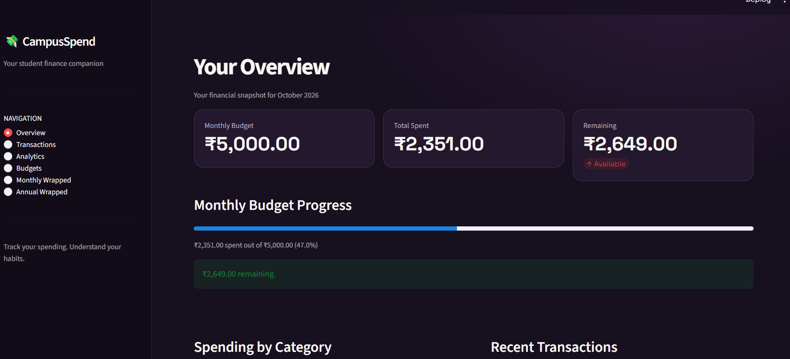
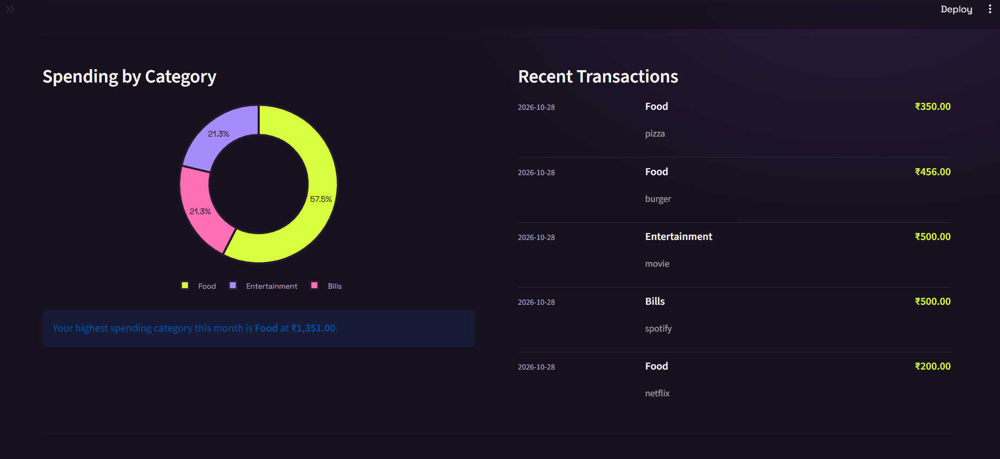
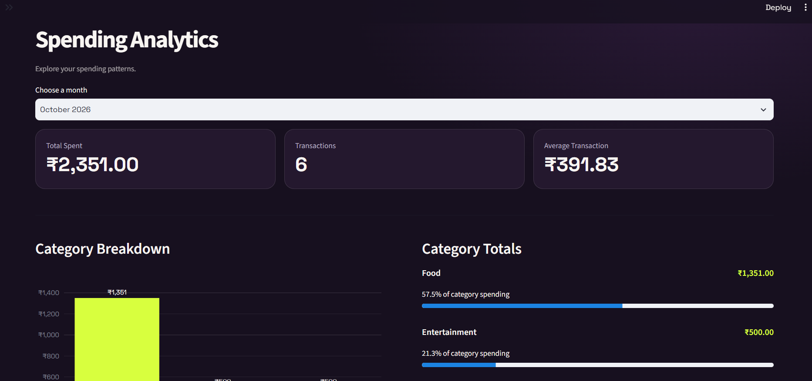
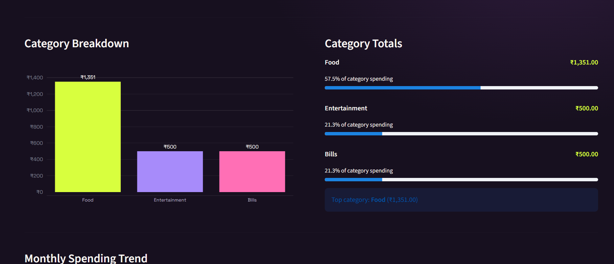
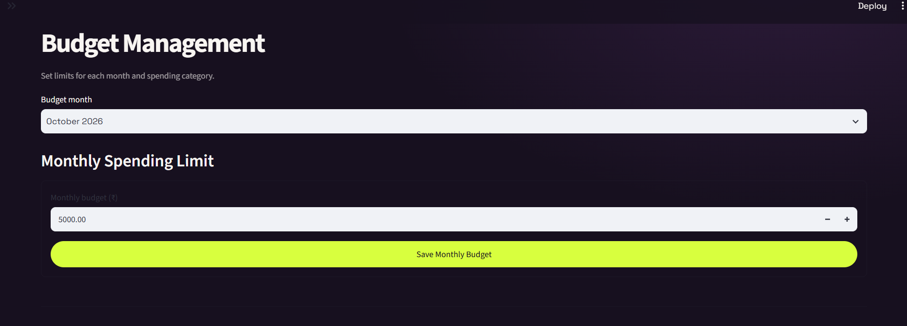
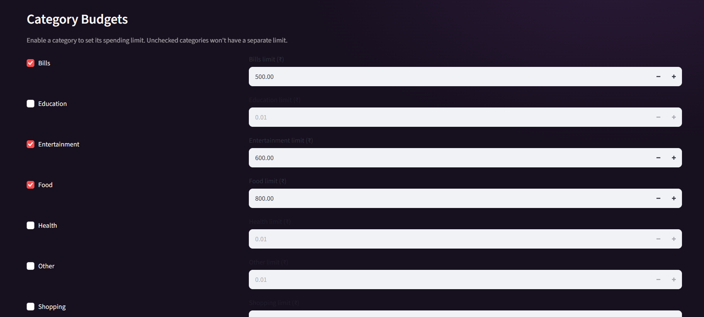

# CampusSpend 💸

**A personal expense tracker designed for college students.**

CampusSpend helps students track daily expenses, manage monthly and category-wise budgets, and understand their spending habits through an interactive dashboard and visual spending summaries.

## Features

- **Expense Tracking** — Add, review, and manage expenses with details such as amount, category, date, and description.
- **Budget Management** — Set monthly spending limits and individual budgets for expense categories.
- **Spending Overview** — View total spending, remaining budget, budget progress, category breakdowns, and recent transactions.
- **Analytics Dashboard** — Explore category-wise spending, monthly trends, and month-over-month comparisons.
- **Monthly Wrapped** — Get a visual recap of monthly spending and budget usage.
- **Annual Wrapped** — Review annual spending, category highlights, and month-by-month trends.
- **Persistent Storage** — Store expenses and budget settings locally using JSON files.
- **Automated Tests** — Test core expense logic, budget calculations, and application functionality.

## Screenshots

### Overview
The main dashboard provides a quick summary of spending, recent transactions, and category breakdowns.





### Transactions
Add, view, and manage personal expenses in one place.


### Analytics
Explore spending patterns through category breakdowns, monthly trends, and comparisons.





### Budgets
Set monthly budgets and category-specific spending limits to keep expenses under control.





### Monthly Wrapped
Review a monthly spending recap with key statistics and visual insights.


### Annual Wrapped
Get a yearly overview of spending habits and trends.


## Tech Stack

- **Language:** Python
- **Dashboard:** Streamlit
- **Data Processing:** Pandas, NumPy
- **Visualizations:** Plotly
- **Storage:** JSON
- **Testing:** Python `unittest`
- **Version Control:** Git and GitHub

## Getting Started

### Prerequisites

- Python installed on your system
- Git (optional, for cloning the repository)

### Installation

1. Clone the repository:

   ```bash
   git clone <YOUR_GITHUB_REPOSITORY_URL>
   cd campus-spend
   ```

2. Install the dependencies:

   ```bash
   python -m pip install -r requirements.txt
   ```

### Run the Dashboard

```bash
python -m streamlit run app.py
```

Streamlit will provide a local URL, usually `http://localhost:8501`, where you can access the dashboard.

### Run the Command-Line Application

```bash
python main.py
```

### Run the Tests

```bash
python -m unittest discover -s tests -v
```

## Data Storage

CampusSpend stores expense records and budget settings in local JSON files. These files are generated as the application is used.

Personal expense data and local configuration files should not be committed to the public repository.

## Project Structure

```text
campus-spend/
├── screenshots/
├── tests/
├── notes/
├── .gitignore
├── README.md
├── app.py
├── expense_logic.py
├── main.py
├── requirements.txt
└── storage.py
```

## Future Improvements

- Export spending summaries and reports.
- Add more personalized spending insights.
- Improve expense filtering and reporting.
- Explore secure backup and data export options.

---

**CampusSpend** — Track your spending. Understand your habits.
